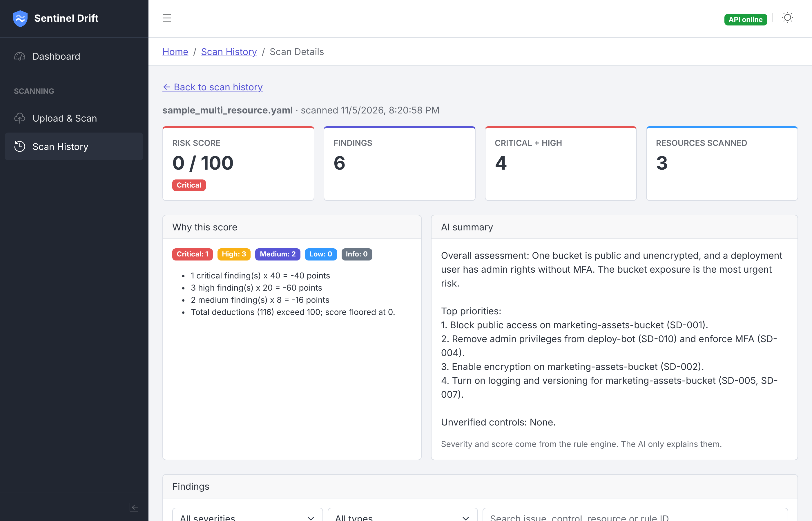

# Sentinel Drift AI

AI-Powered Security Control Drift & Misconfiguration Detection

Societe Generale Hackathon Project

Sentinel Drift scans infrastructure configuration for security
misconfigurations and drift from an approved baseline, scores the risk with an
explainable formula, adds an AI summary of what to fix first, and keeps a
history of every scan.



## How it works

```
Upload JSON/YAML ─► Parser ─► Rule engine ─┐
                                            ├─► Risk engine ─► AI summary ─► Supabase
                    Baseline ─► Drift engine┘   (score + why)   (explains,     (history)
                                                                 never scores)
```

- **Rule engine:** security rules defined as data in YAML. A control that is
  missing is reported, never silently passed.
- **Drift engine:** compares each resource with its approved baseline and
  reports added, removed and changed settings.
- **Risk engine:** a 0–100 score with plain-language reasons. One critical
  finding can never be rated better than "High Risk".
- **AI summary (Gemini):** explains the findings and prioritizes fixes. It only
  receives structured, truncated findings, never the raw upload.

More detail: [docs/ARCHITECTURE.md](docs/ARCHITECTURE.md)

## Project structure

```
Sentinel Drift AI/
├── backend/            FastAPI API, scan engines, tests   (see backend/README.md)
├── frontend/           React + Vite + CoreUI dashboard    (see frontend/README.md)
├── docs/               Architecture notes and screenshots
└── docker-compose.yml  Run both with Docker
```

## Quick start (Windows, Command Prompt)

Prerequisites: Python 3.12+, Node.js 20+, a Supabase project (optional), a
Gemini API key (optional).

**1. Backend**

```cmd
cd backend
python -m venv venv
venv\Scripts\activate
pip install -r requirements.txt
copy .env.example .env
```

Fill in `backend\.env` (Supabase URL + service role key, Gemini key). Without
Supabase the app still works, keeping scans in memory until restart. Then
create the table once: Supabase → SQL Editor → run
`backend\migrations\001_create_scans.sql`.

```cmd
python -m pytest
uvicorn app.main:app --reload --port 8000
```

**2. Frontend** (second terminal)

```cmd
cd frontend
npm install
npm start
```

The browser opens at http://localhost:3000. Go to **Upload & Scan** and try the
files in `backend\uploads\`.

## Run with Docker

```cmd
copy backend\.env.example backend\.env
docker compose up --build
```

- Frontend: http://localhost:3000
- Backend: http://localhost:8000 (API docs at `/docs`)

## Status

Built: upload and scan, YAML rules, baseline drift, explainable risk score,
AI summary, scan history, dashboard.

Next: authentication and multi-tenancy (Supabase Auth + row-level security per
organization), baseline approval workflow, cloud connectors (AWS first),
remediation verification by re-scanning.
